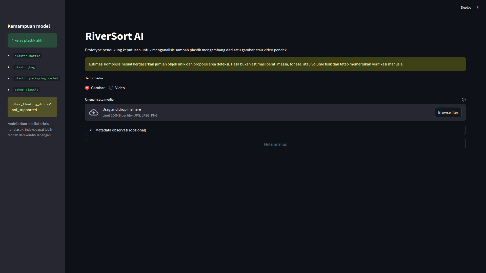

# RiverSort AI

RiverSort AI is a computer vision prototype for analyzing images and short videos of river surfaces. It detects floating plastic waste, summarizes its visual composition, calculates a visual cleanup-priority index, and generates traceable, rule-based recommendations. The application is intended to support the review of visual observations; its outputs should not be interpreted as direct measurements of physical waste quantities.



## Capabilities

RiverSort AI currently provides the following capabilities:

- Analyze a single JPEG or PNG image, or an MP4 video encoded with H.264.
- Detect four plastic-waste classes using YOLO11n.
- Count unique objects in videos using a two-stage ByteTrack process.
- Automatically normalize high-resolution media before analysis.
- Calculate two visual-composition metrics: the proportion of unique objects and the proportion of detected area.
- Produce a visual-priority index whose contributing components can be inspected.
- Generate deterministic, rule-based recommendations together with the observed values and the thresholds used by the rules.
- Display annotated previews and export analysis results in JSON and CSV formats.
- Process media locally without relying on an external inference service.

The active model supports the following four classes:

```text
plastic_bottle
plastic_bag
plastic_packaging_sachet
other_plastic
```

The target taxonomy also includes `other_floating_debris`. This class is not supported by the active model. It is therefore reported as `not_supported`, rather than being assigned a value of `0%`. This distinction is important: an unsupported class should not be interpreted as a class that was evaluated and found to be absent.

## Installation

### Prerequisites

Make sure the following software is available:

- Python 3.11
- FFmpeg and FFprobe
- Git

### Set up the project

Clone the repository, enter the project directory, create a virtual environment, and install the project with its development dependencies:

```bash
git clone https://github.com/b1n0r10n/riversort-ai.git
cd riversort-ai

python3.11 -m venv .venv
source .venv/bin/activate
python -m pip install --upgrade pip
python -m pip install -e ".[dev]"
```

### Download the model

Download the verified model weights:

```bash
python scripts/download_model.py
export RIVERSORT_MODEL_PATH="$PWD/models/riversort-yolo11n-fpwr4-0.1.0-baseline.1.pt"
```

### Start the dashboard

Run the Streamlit application:

```bash
streamlit run app.py
```

Once the model weights are available locally, the application can be used without an internet connection. For detailed instructions on setup, configuration, dashboard operation, and exports, see the [usage guide](docs/USAGE.md).

## Analysis workflow

The analysis pipeline follows these main stages:


The aggregation process differs depending on the input media:

- **Images:** Each valid detection is counted as one object.
- **Videos:** Detections across frames are associated into tracks. This prevents the same object from being counted again in every frame in which it appears.

For each video track, the final class is determined using a *confidence-weighted vote*. That assigned class is then used consistently in both the annotated preview and the aggregated results.

## Model and data

The baseline model uses the `riversort_fpwr4-20260722-r2` snapshot, derived from Float Plastic Waste River v6. Its dataset and evaluation setup have the following characteristics:

- 2,824 images and 5,761 annotations.
- A *group-aware* split consisting of 1,947 training images, 437 validation images, and 440 test images.
- Four active plastic-waste classes.
- No negative samples in the dataset.
- River Trash is not included in the numerical evaluation.

The active model is YOLO11n `0.1.0-baseline.1`. On the held-out FPWR test set, using a confidence threshold of `0.40` and an IoU threshold of `0.50`, it achieved:

- mAP50: `0.6936`
- Macro-F1: `0.6904`

These metrics describe the model's performance on the FPWR test set under the stated evaluation settings. They should not be interpreted as evidence of national-level accuracy or as a guarantee of performance across different rivers, locations, or field conditions.

For additional context, see the [model card](models/MODEL_CARD.md) and the [data and model methodology](docs/DATA_AND_MODEL.md).

## Project structure

The repository is organized into the following main directories and files:

```text
app.py                         Streamlit application entry point
src/riversort/domain/          contracts, metrics, and business rules
src/riversort/application/     image and video analysis orchestration
src/riversort/adapters/        YOLO, OpenCV, ByteTrack, FFmpeg, and export adapters
src/riversort/infrastructure/  configuration, logging, runtime, and workspace
src/riversort/presentation/    Streamlit dashboard
configs/                       model, tracker, media, and rule configurations
scripts/                       data and model pipelines, plus release utilities
tests/                         unit and integration tests
docs/                          product and technical documentation
models/                        model card; model weights are downloaded separately
reports/                       evaluation summaries and snapshots
```

RiverSort AI follows a *modular monolith* architecture. It is implemented as a single local application, with defined dependency boundaries between the domain layer, application orchestration, adapters, and user interface. This structure separates the main responsibilities of the application without presenting them as independently deployed services.

## Testing

Run the following commands from the project root:

```bash
python -m pytest -q
python -m pip check
python scripts/release/audit_public_repository.py
```

The test suite covers data contracts, configuration, media validation, visual composition, priority calculations, recommendations, tracking, exports, workspace cleanup, and a dashboard smoke test.

## Intended use and limitations

RiverSort AI is a decision-support tool. It is not a physical measurement instrument and does not perform automated river cleanup.

> **Visual composition estimates based on unique-object counts and the proportion of detected area.**

The results do not represent the physical weight, mass, tonnage, or volume of waste. The model may produce *false positives* and *false negatives*, particularly for small or partially occluded objects and in visually dense scenes.

Non-plastic debris is not currently supported by the active model. As a result, the priority index may be lower than what the actual field conditions would suggest. Human review and verification are still required before cleanup actions are taken.

These limitations should be considered when interpreting the analysis and using its recommendations.

## Documentation

The following documents provide additional information about the project:

| Document | Description |
|---|---|
| [PRODUCT.md](docs/PRODUCT.md) | Problem context, intended users, objectives, scope, and requirements |
| [ARCHITECTURE.md](docs/ARCHITECTURE.md) | Application architecture, data flow, tracking process, and business rules |
| [DATA_AND_MODEL.md](docs/DATA_AND_MODEL.md) | Dataset, data snapshot, training process, and model details |
| [EVALUATION.md](docs/EVALUATION.md) | Evaluation metrics, tests, failure modes, and interpretation |
| [USAGE.md](docs/USAGE.md) | Installation, configuration, dashboard usage, and exports |
| [ROADMAP.md](docs/ROADMAP.md) | Development direction and validation gates |
| [DECISIONS.md](docs/DECISIONS.md) | Current product and technical decisions |

## Team

- **Bintang Akalla Junjunan** — Product, application development, and machine learning
- **Nisa Setiawati** — Research, validation, and communication

## License

The RiverSort AI source code and model are made available under the [GNU Affero General Public License v3.0 or later](LICENSE).

The FPWR dataset remains subject to the CC BY 4.0 license granted by its owner. Further attribution details are provided in [NOTICE.md](NOTICE.md).
