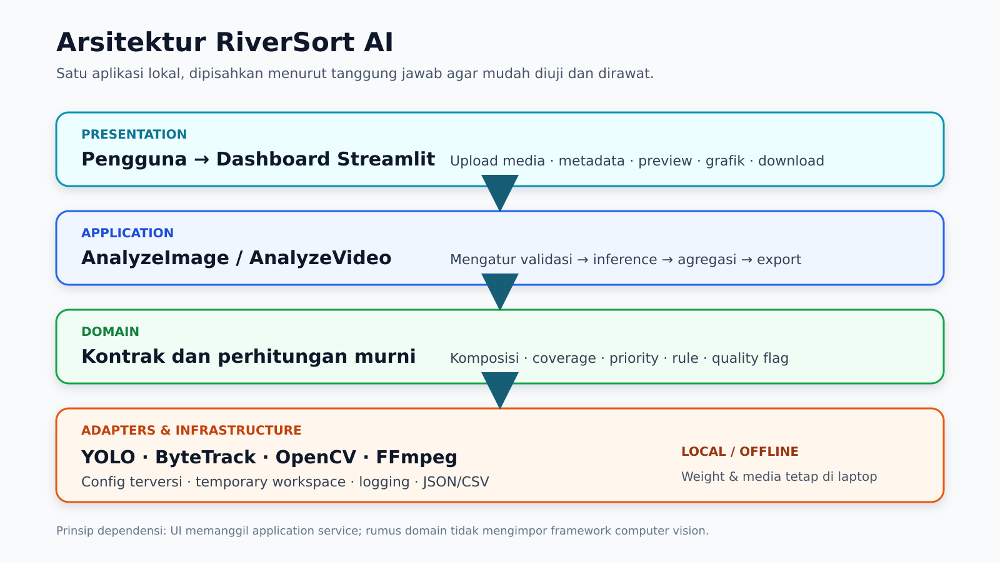
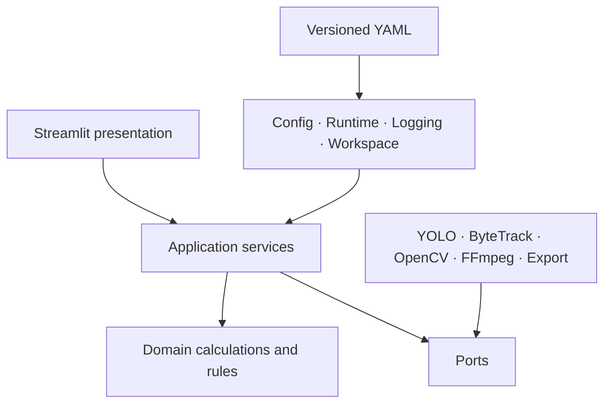
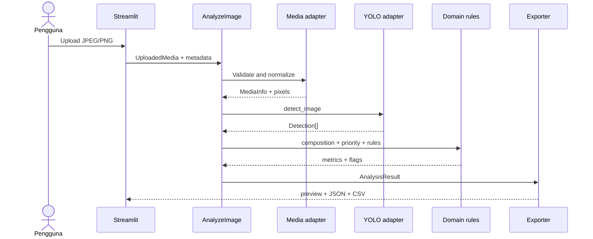
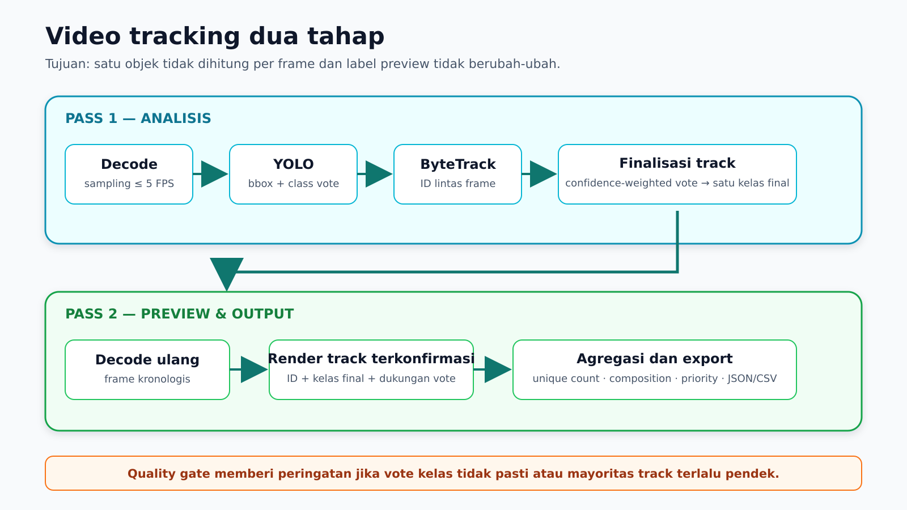

# System architecture

## Bentuk sistem

RiverSort AI adalah *modular monolith*: dashboard, application services,
domain logic, dan adapter dijalankan sebagai satu proses lokal. Pemisahan
modul dipakai untuk menjaga dependensi dan kemudahan pengujian, bukan untuk
membuat layanan terdistribusi.





## Lapisan

### Domain

`src/riversort/domain/` berisi kontrak stabil dan fungsi deterministik:

- composition dan rectangle-union coverage;
- priority score;
- recommendation rules;
- quality flags;
- wire serialization schema `1.0.0`.

Domain hanya menggunakan Python standard library. Dengan demikian, formula
dapat diuji tanpa model, OpenCV, atau dashboard.

### Application

`src/riversort/application/` mengorkestrasi use case:

- `AnalyzeImage`;
- `AnalyzeVideo`;
- DTO media dan result bundle;
- port untuk detector, tracker, media, annotator, exporter, dan workspace.

Application layer menentukan urutan kerja, sedangkan implementasi library
berada di adapter.

### Adapters

`src/riversort/adapters/` menghubungkan port dengan teknologi:

- Ultralytics YOLO11n untuk detection;
- ByteTrack untuk object tracking;
- OpenCV untuk decode dan annotation;
- FFmpeg/FFprobe untuk validasi dan encoding video;
- JSON/CSV exporter.

Object library tidak disimpan dalam kontrak domain. Semua hasil dikonversi ke
`Detection`, `TrackSummary`, atau byte output.

### Infrastructure

`src/riversort/infrastructure/` menangani:

- loading dan validasi YAML;
- pencocokan model dengan capability profile;
- structured logging;
- temporary workspace;
- perakitan runtime.

### Presentation

`src/riversort/presentation/` menampilkan alur Streamlit. UI hanya membaca
`AnalysisBundle`; formula priority dan recommendation tidak dihitung ulang.

## Kontrak utama

| Tipe | Fungsi |
|---|---|
| `UploadedMedia` | Nama display, bytes, dan MIME yang dinyatakan. |
| `MediaInfo` | Format, ukuran, resolusi, FPS, durasi, codec, dan normalisasi. |
| `Detection` | Kelas, confidence, bbox, frame, dan timestamp. |
| `TrackSummary` | ID, kelas akhir, vote, area, rentang frame, dan stabilitas. |
| `ModelCapabilityProfile` | Kelas yang didukung dan belum didukung. |
| `CompositionMetric` | Count/share/area untuk satu target class. |
| `PriorityAssessment` | Status, score, tier, scope, dan kontribusi. |
| `Recommendation` | Rule, evidence, threshold, reason, dan action. |
| `QualityFlag` | Kode kualitas beserta evidence terukur. |
| `AnalysisResult` | Hasil kanonis yang menjadi sumber UI dan export. |

Local temporary path ditandai nonserializable. Enum selalu diekspor dengan
identifier string yang stabil.

## Alur gambar



Satu detection valid pada gambar merupakan satu objek. Coverage dihitung dari
union seluruh bbox agar area tumpang tindih tidak dihitung dua kali.

## Alur video



### Pass 1: detection dan tracking

- Video dibaca kronologis hingga 5 FPS.
- Detector dapat memberikan detection ke tracker mulai confidence `0,10`.
- Track baru memerlukan confidence `0,40`.
- ByteTrack menghubungkan observation antar-frame.
- Track dikonfirmasi setelah sedikitnya dua observation.
- Kelas akhir dipilih dari total confidence vote per kelas.
- Vote margin mengukur jarak dua kelas terkuat.

### Pass 2: preview stabil

Video dibaca kembali. Hanya track terkonfirmasi yang ditampilkan dan setiap
frame menggunakan kelas akhir yang sama. Langkah ini mencegah label pada
preview berubah mengikuti prediksi mentah per frame.

### Quality gate

- `CLASSIFICATION_UNCERTAIN`: track terkonfirmasi memiliki vote margin di bawah
  `0,20`.
- `TRACKING_UNSTABLE`: sedikitnya tiga track terkonfirmasi dan lebih dari 50%
  track bertahan kurang dari satu detik.
- `LOW_ANALYSIS_QUALITY`: evidence media atau decode melewati batas konfigurasi.

Pada kondisi tidak stabil, count diperlakukan sebagai indikatif.

## Komposisi visual

### Proporsi jumlah

Untuk kelas \(c\):

```text
count_share(c) = unique_objects(c) / total_unique_supported_objects
```

Gambar memakai detection valid. Video memakai confirmed unique track.
Kelas yang tidak didukung tidak masuk denominator dan metriknya `null`.

### Proporsi area

Gambar menggunakan jumlah luas bbox per kelas dibandingkan total luas semua bbox
yang didukung. Video memakai median normalized bbox area untuk setiap unique
track sebelum agregasi kelas. Bounding box bukan segmentasi dan bukan ukuran
fisik sampah.

### Coverage

Coverage priority memakai union area bbox per frame. Untuk video, nilai akhir
adalah percentile ke-90 dari coverage sampled frames.

## Priority score

```text
coverage_norm = min(p90_coverage / 0.20, 1)
count_norm    = min(object_count / 20, 1)                  # gambar
                min(unique_tracks_per_minute / 30, 1)      # video
mobility      = plastic_bag_share + plastic_packaging_sachet_share

score = round_half_up(100 × (
    0.55 × coverage_norm +
    0.30 × count_norm +
    0.15 × mobility
))
```

Tier:

- `low`: 0–34;
- `medium`: 35–69;
- `high`: 70–100.

Jika tidak ada objek valid, status menjadi `not_assessable`; bukan `low`.
Scope score selalu `supported_classes_only`.

## Recommendation engine

Rules dibaca dari `configs/recommendations.yaml`. Setiap output memuat:

```text
rule_id
rule_version
observed_metric
observed_value
operator
threshold
reason
action
evidence_fields
```

Beberapa rule dapat aktif sekaligus. Rule untuk debris nonplastik tetap ada
sebagai konfigurasi masa depan, tetapi tidak berlaku pada profile empat kelas.

## Media dan workspace

- Gambar maksimal 20 MB dan safety limit 80 megapixel; target pemrosesan
  25 megapixel.
- Video maksimal 200 MB, 60 detik, dan safety limit 8K/33,177,600 pixel;
  target pemrosesan maksimal 1920×1080.
- Aspect ratio dipertahankan selama normalisasi.
- Setiap analisis memakai workspace acak berdasarkan `analysis_id`.
- Nama file pengguna disanitasi dan tidak dipakai sebagai lokasi filesystem.
- Workspace dibersihkan ketika use case selesai atau melempar exception.

## Error contract

Error publik menggunakan identifier stabil, antara lain:

```text
INVALID_MEDIA_TYPE
FILE_TOO_LARGE
IMAGE_TOO_LARGE
DECODE_FAILED
UNSUPPORTED_CODEC
VIDEO_TOO_LONG
MODEL_NOT_READY
MODEL_CHECKSUM_MISMATCH
MODEL_CLASS_MAP_MISMATCH
INFERENCE_FAILED
TRACKING_FAILED
ENCODER_UNAVAILABLE
EXPORT_FAILED
```

UI menampilkan recovery action tanpa stack trace atau absolute path.
