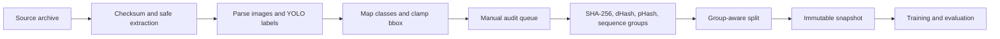

# Data and model

## Sumber baseline

Baseline aktif menggunakan Float Plastic Waste River (FPWR) v6 dari Roboflow
Universe:

- sumber: <https://universe.roboflow.com/floatplasticwasteriver/float-plastic-waste-river/dataset/6>;
- lisensi: CC BY 4.0;
- export: 2.824 gambar dan 5.761 anotasi;
- empat kelas sumber.

Dataset tidak disimpan di repository ini. Pengguna harus mengunduh dari sumber,
mematuhi lisensi, dan menyimpan data di luar checkout Git.

Inventory eksperimen awal berisi 4.682 gambar dari FPWR dan River Trash.
Angka 4.682 bukan clean training set. River Trash tidak masuk training,
validation, atau test numerik karena sebagian besar bbox hasil export memenuhi
seluruh frame dan tidak layak sebagai localization ground truth.

## Taksonomi

Target taxonomy memiliki lima kelas:

```text
0 plastic_bottle
1 plastic_bag
2 plastic_packaging_sachet
3 other_plastic
4 other_floating_debris
```

Profile `riversort_plastic4_mvp` hanya mendukung ID 0–3. ID 4 tetap ada agar
kontrak target eksplisit, tetapi selalu dilaporkan sebagai `not_supported`.

Mapping FPWR:

| ID sumber | Kelas sumber | ID target | Kelas target |
|---:|---|---:|---|
| 0 | `other_plastic` | 3 | `other_plastic` |
| 1 | `plastic_bag` | 1 | `plastic_bag` |
| 2 | `plastic_bottle` | 0 | `plastic_bottle` |
| 3 | `plastic_package` | 2 | `plastic_packaging_sachet` |

## Pipeline dataset



### Raw dan staging

Archive sumber dianggap immutable. Perubahan hanya terjadi di staging:

- decode semua gambar;
- parse seluruh YOLO row;
- menolak class ID tidak dikenal dan nilai non-finite;
- konversi `xywh → xyxy`, clamp ke `[0,1]`, lalu kembali ke `xywh`;
- mencatat nilai sebelum dan sesudah koreksi.

Sebanyak 135 bbox pada 117 label file memerlukan clamp. Tidak ada negative
sample palsu yang dibuat.

### Audit

Audit queue seed 42 mencakup:

- sampel stratified per kelas;
- seluruh overflow case;
- gambar dengan lebih dari 10 objek;
- bbox ekstrem;
- multi-class images;
- kandidat visual duplicate dan sequence.

Ringkasan audit snapshot:

- 785 gambar pada queue diterima;
- 36 candidate dHash groups yang mencakup 185 gambar;
- 530 dHash candidate edges;
- 2.153 sequence candidate edges;
- 0 gambar ditolak pada snapshot aktif.

### Grouping dan split

SHA-256 membentuk exact duplicate group. dHash/pHash dan nama sequence hanya
membentuk candidate edge yang perlu dinilai. Connected components dari accepted
edges menjadi group final.

Split memakai seed 42 dan assignment group-aware sehingga satu group tidak
tersebar ke train, validation, dan test. Snapshot aktif:

| Split | Gambar |
|---|---:|
| Train | 1.947 |
| Validation | 437 |
| Test | 440 |
| Total | 2.824 |

Group count `1.635` dan group leakage terukur `0`.

## Snapshot aktif

```text
snapshot_id:
riversort_fpwr4-20260722-r2

snapshot_tree_sha256_v1:
74badb41175aacef724f6b2c4db722ce46dcd6875546f9035472d60e46690b2c
```

R2 menggantikan R1 untuk menghapus field `path` yang ambigu pada
`dataset.yaml`. Images, labels, split, dan instance count tidak berubah.

Metadata numerik tersedia di
[reports/dataset_snapshot.json](../reports/dataset_snapshot.json).

## Training baseline

Model:

```text
architecture: YOLO11n detection
epochs: 100
patience: 20
batch: 8
imgsz: 640
seed: 42
deterministic: true
cache: false
amp: true
```

Augmentasi online hanya digunakan pada train. Validation dan test tidak
memakai augmentasi acak. Training config lengkap tersedia di
`configs/training_yolo11n_baseline.yaml`.

Pemilihan confidence dilakukan pada validation split menggunakan grid
0,05–0,50 dengan objective macro-F1 empat kelas. Confidence `0,40` dikunci
sebelum evaluasi test.

Runtime memakai inference image size `960`; perubahan ini meningkatkan
sensitivitas pada media aktual tanpa mengubah weight atau threshold.

## Reproduksi pipeline

Tetapkan data root di luar repository:

```bash
export RIVERSORT_DATA_ROOT=../RiverSort_AI_Data
```

CLI dataset:

```bash
python scripts/data_pipeline/cli.py --help
```

CLI model:

```bash
python scripts/model_pipeline/cli.py --help
```

Raw export, snapshot, dan runs tidak boleh diletakkan di Git. Manifest,
checksum, konfigurasi, serta laporan kecil dapat disimpan untuk
reproduksibilitas.

## Keterbatasan data

- Data training hanya berasal dari FPWR.
- Tidak ada negative sample yang memadai.
- Domain sumber tidak seragam; sebagian gambar berada di tepi/darat.
- Dense scene dapat memiliki objek yang tidak diberi anotasi.
- Debris nonplastik belum memiliki training set yang lolos quality gate.
- Evaluasi belum membuktikan generalisasi nasional.
