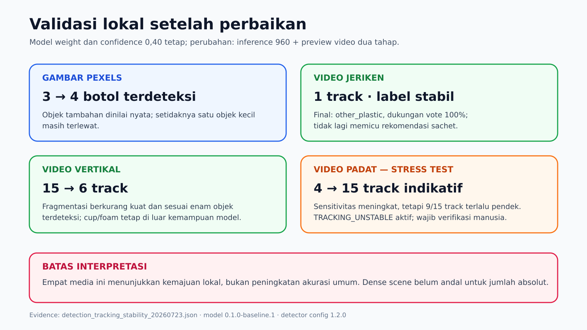
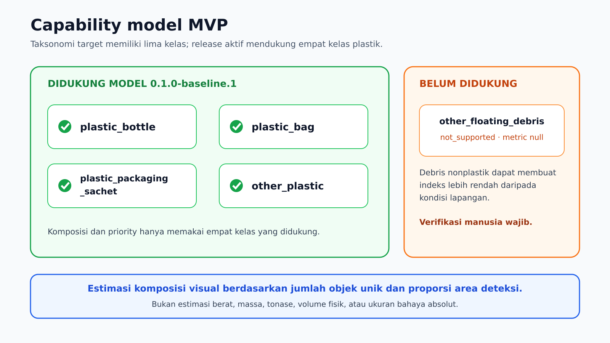

# Evaluation

## Ruang lingkup

Evaluasi memisahkan tiga hal:

1. performa detector pada held-out FPWR;
2. stabilitas tracking pada video terkontrol;
3. ketepatan implementasi aplikasi melalui automated tests.

Metrik detector tidak boleh ditafsirkan sebagai akurasi nasional atau jaminan
untuk semua kondisi sungai.

## Detector

Held-out test berisi 440 gambar. Confidence `0,40` dipilih pada validation,
kemudian dikunci sebelum test. Matching memakai IoU `0,50` dengan greedy
one-to-one class matching.

| Kelas | Precision | Recall | F1 | AP50 |
|---|---:|---:|---:|---:|
| `plastic_bottle` | 0,8535 | 0,8481 | 0,8508 | 0,8802 |
| `plastic_bag` | 0,7778 | 0,6488 | 0,7074 | 0,7113 |
| `plastic_packaging_sachet` | 0,7249 | 0,7959 | 0,7588 | 0,8156 |
| `other_plastic` | 0,5625 | 0,3673 | 0,4444 | 0,3675 |

Ringkasan:

- mAP50: `0,6936`;
- macro-F1: `0,6904`;
- false positives/image: `0,4227`;
- missed objects/image: `0,5273`;
- latency batch-1 pada RTX 4050 Laptop GPU: median `6,48 ms`, p90 `6,76 ms`.

Latency diukur setelah 20 warmup pada 100 test images. Nilai tersebut merupakan
benchmark detector pada hardware dan konfigurasi tertentu, bukan waktu
end-to-end dashboard.



## Failure review

Pola kegagalan utama:

- objek kecil dan jauh;
- occlusion dan tumpukan sampah padat;
- refleksi air dan kontras rendah;
- confusion antara sachet, bag, dan `other_plastic`;
- recall `other_plastic` lebih rendah daripada tiga kelas lain;
- domain gambar sumber tidak seluruhnya merepresentasikan permukaan sungai.

Pada 50 gambar River Trash yang dipilih dengan seed 42, model menghasilkan
prediksi pada 22 gambar. Hasil ini hanya review kualitatif karena anotasi River
Trash tidak layak sebagai localization ground truth.

## Tracking

Video memakai ByteTrack dua tahap dan menghitung confirmed unique track.
Acceptance fixture menilai:

- satu objek sepanjang video tetap satu track;
- crossing/occlusion tidak menghasilkan fragmentasi berlebihan;
- kelas final preview sama dengan `TrackSummary`, komposisi, JSON, dan CSV;
- track kurang dari dua observation tidak dihitung;
- dense scene memicu quality flag ketika track didominasi track pendek.

Tracking gate pada beberapa video pendek digunakan untuk kesiapan demonstrasi,
bukan metrik generalisasi ilmiah. Dense scene tetap diperlakukan sebagai count
indikatif.

## Automated tests

Test mencakup:

- config dan capability profile;
- schema serialization tanpa local path;
- import boundary domain;
- media signature, ukuran, resolusi, codec, dan normalisasi;
- image/video use case;
- ByteTrack vote, tie-break, confirmation, dan stability evidence;
- composition share dan rectangle-union coverage;
- percentile ke-90;
- priority boundary 34/35 dan 69/70;
- strict recommendation thresholds;
- unsupported class semantics;
- JSON/CSV export;
- workspace cleanup;
- Streamlit smoke page.

Release baseline menjalankan 88 tests dengan snapshot lokal. Pada clean clone
tanpa dataset, test integrasi snapshot dilewati dengan alasan eksplisit,
sementara test lain tetap berjalan.

## Cara menjalankan

```bash
python -m pytest -q
python -m pip check
python scripts/release/audit_public_repository.py
```

Untuk menyertakan snapshot integration test:

```bash
export RIVERSORT_DATA_ROOT=../RiverSort_AI_Data
python -m pytest -q
```

## Interpretasi

Hasil positif menunjukkan bahwa model menemukan pola yang dipelajari dari
FPWR. Hasil negatif tidak membuktikan ketiadaan sampah. Count video bergantung
pada kualitas detection dan tracking. Semua output harus dibaca bersama
quality flags dan keterbatasan.


